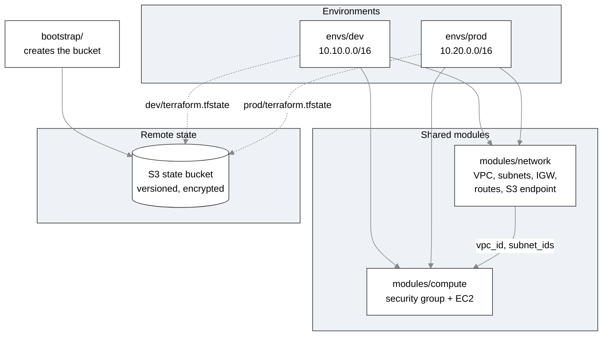

# terraform-aws-remote-state-modules

A Terraform project that separates infrastructure into reusable modules, stores state remotely in S3, and builds two isolated environments (dev and prod) from the same code.

This is the second project in a series. The first, `terraform-aws-vpc-ec2`, built a single flat configuration with local state. This one fixes the problems that approach has once more than one environment or more than one person is involved.

## Architecture



## Project structure

```
.
├── bootstrap/
│   └── main.tf              creates the S3 state bucket (run once)
├── modules/
│   ├── network/             VPC, subnets, internet gateway, routes, S3 endpoint
│   └── compute/             security group and EC2 web server
└── envs/
    ├── dev/                 calls both modules with dev settings
    └── prod/                calls both modules with prod settings
```

## What each part does

| Part | Purpose |
|---|---|
| `bootstrap/` | Creates the S3 bucket that holds state for every environment. Versioning, encryption, and Block Public Access are enabled, and `prevent_destroy` blocks accidental deletion. |
| `modules/network` | Builds the VPC, two public subnets, an internet gateway, a public route table, and a free S3 gateway endpoint. Returns the VPC ID and subnet IDs. |
| `modules/compute` | Builds a security group and an Amazon Linux 2023 web server. Receives the VPC and subnet as inputs, so it works in any network. |
| `envs/dev`, `envs/prod` | Root modules. Each calls the two modules above and uses its own state file and address range. |

## Prerequisites

- An AWS account and an IAM user configured with `aws configure`
- Terraform 1.10 or later (required for S3 native state locking)
- AWS CLI v2
- Git

## Usage

### 1. Create the state bucket (once)

```
cd bootstrap
terraform init
terraform apply
terraform output state_bucket
```

Copy the bucket name that is printed. Bootstrap uses local state, because the bucket does not exist yet to hold it.

### 2. Configure an environment

In `envs/dev`, create a file named `backend.hcl` with your bucket name:

```
bucket       = "tfstate-<account-id>-us-east-1"
key          = "dev/terraform.tfstate"
region       = "us-east-1"
encrypt      = true
use_lockfile = true
```

Create a file named `terraform.tfvars` in the same folder:

```
allowed_cidr = "203.0.113.5/32"
```

Use your own public IPv4 address followed by `/32`, with no spaces inside the quotes. Both files are ignored by Git.

For prod, repeat the same steps in `envs/prod`, using `key = "prod/terraform.tfstate"`.

### 3. Deploy

```
cd envs/dev
terraform init -backend-config=backend.hcl
terraform plan
terraform apply
```

Open the `web_public_ip` output in a browser using `http://`. The page may take a minute or two to appear.

### 4. Clean up

```
terraform destroy
```

Run it in each environment folder. Do not destroy the `bootstrap` bucket while any environment still uses it.

## Inputs (per environment)

| Variable | Description | Dev default | Prod default |
|---|---|---|---|
| `region` | AWS region | `us-east-1` | `us-east-1` |
| `project_name` | Prefix for names and tags | `tf-modules-dev` | `tf-modules-prod` |
| `vpc_cidr` | VPC address range | `10.10.0.0/16` | `10.20.0.0/16` |
| `public_subnet_cidrs` | One CIDR per public subnet | `10.10.1.0/24`, `10.10.2.0/24` | `10.20.1.0/24`, `10.20.2.0/24` |
| `instance_type` | EC2 instance size | `t3.micro` | `t3.micro` |
| `allowed_cidr` | IP allowed to reach the web server | none, must be set | none, must be set |

## Cost

The project is designed to stay within the AWS Free Tier. The VPC, subnets, internet gateway, route tables, security group, and S3 gateway endpoint have no charge, and the state bucket holds only a few small files. The EC2 instances are billed by the hour while running, so destroy each environment when you finish. Run only one environment at a time to avoid using free tier hours twice as fast.

## Design decisions

- **Remote state in S3.** State on one laptop is lost if the laptop is lost, cannot be shared, and can be corrupted by two runs at once. S3 gives durability, versioning for rollback, and encryption.
- **Native S3 locking.** `use_lockfile` prevents two runs from changing state at the same time without needing a separate DynamoDB table.
- **A separate bootstrap configuration.** Terraform needs the bucket to exist before it can store state in it, so a small configuration creates the bucket first, using local state.
- **`prevent_destroy` on the state bucket.** Losing the bucket means losing the record of everything Terraform built, so Terraform refuses any plan that would delete it.
- **Separate state keys per environment.** Dev and prod use different state files in the same bucket, so a mistake in one cannot affect the other.
- **Modules with one job each.** The compute module has no VPC or subnet inside it. It receives them as inputs, so it can be reused in any network, and environments differ only by the values they pass in.
- **No hardcoded environment values in modules.** Names, address ranges, and instance sizes are all inputs.
- **Non-overlapping address ranges.** Dev uses `10.10.0.0/16` and prod uses `10.20.0.0/16`, so the two networks could be connected later without conflicts.
- **Partial backend configuration.** The backend block cannot use variables, so the bucket name lives in a Git-ignored `backend.hcl` file. This keeps the AWS account ID out of the public repository.
- **Input validation.** The `allowed_cidr` variable checks its own format, so a typo produces a clear message instead of an error deep inside a module.
- **No NAT gateway.** Instances stay in public subnets and use a free S3 gateway endpoint, which avoids hourly NAT charges.

## Known limitations

- The bootstrap configuration keeps its own state locally, and that file is not committed. If it is lost, the bucket would need to be imported into a new state before bootstrap could manage it again. Applying bootstrap a second time without that state would try to create a bucket that already exists.
- Both environments use the same AWS account. Real production setups usually separate accounts for stronger isolation.
- There is no CI pipeline yet. Formatting, validation, and plans are run by hand.

## What I learned

- **An empty configuration is valid.** `terraform plan` reported "No changes" because the module calls were missing from `main.tf`. Terraform can only compare what it is told to manage, so an empty or misplaced file looks like a success.
- **Invisible characters break values.** A stray space inside the quotes of `allowed_cidr` produced an invalid CIDR error that looked identical to a placeholder error. Retyping the value by hand fixed it.
- **Plan cannot catch every error.** A subnet range that does not fit inside its VPC range passes `plan`, because the VPC does not exist yet, and AWS only rejects it during `apply`. A malformed range such as `10.20.1.0/16` is caught at plan time.
- **Partial applies leave real resources behind.** A failed apply had already created the VPC and gateway, so it needed a `terraform destroy` before retrying.
- **Each environment folder is independent.** It needs its own `terraform.tfvars`, `backend.hcl`, and `terraform init`.

## Next steps

- Add GitHub Actions to run `fmt`, `validate`, and `plan` on pull requests
- Add security scanning with tflint and Checkov
- Replace hand-typed subnet ranges with `cidrsubnet()`
- Use separate AWS accounts for dev and prod
